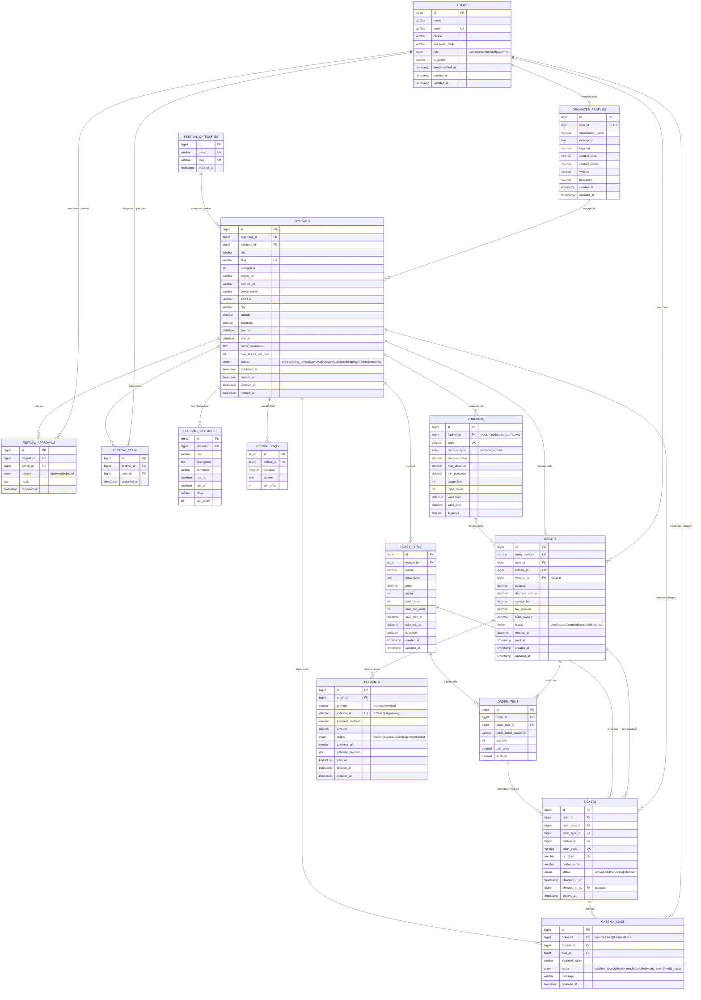
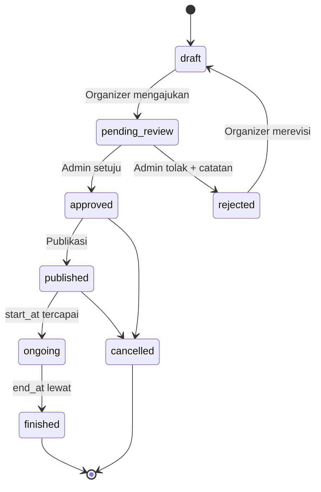
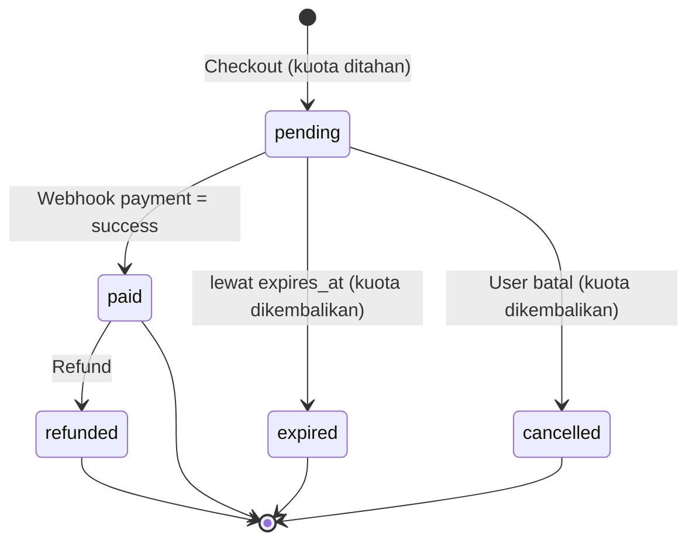
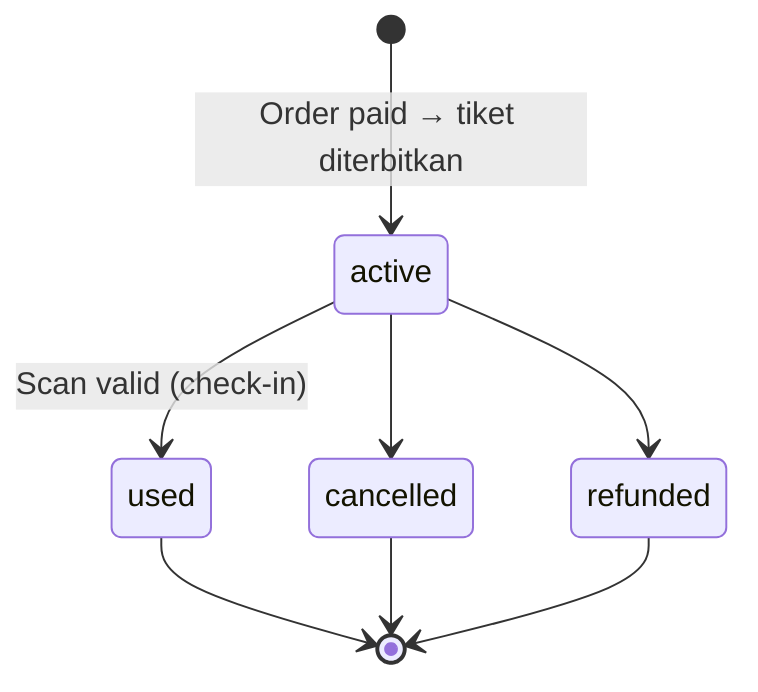
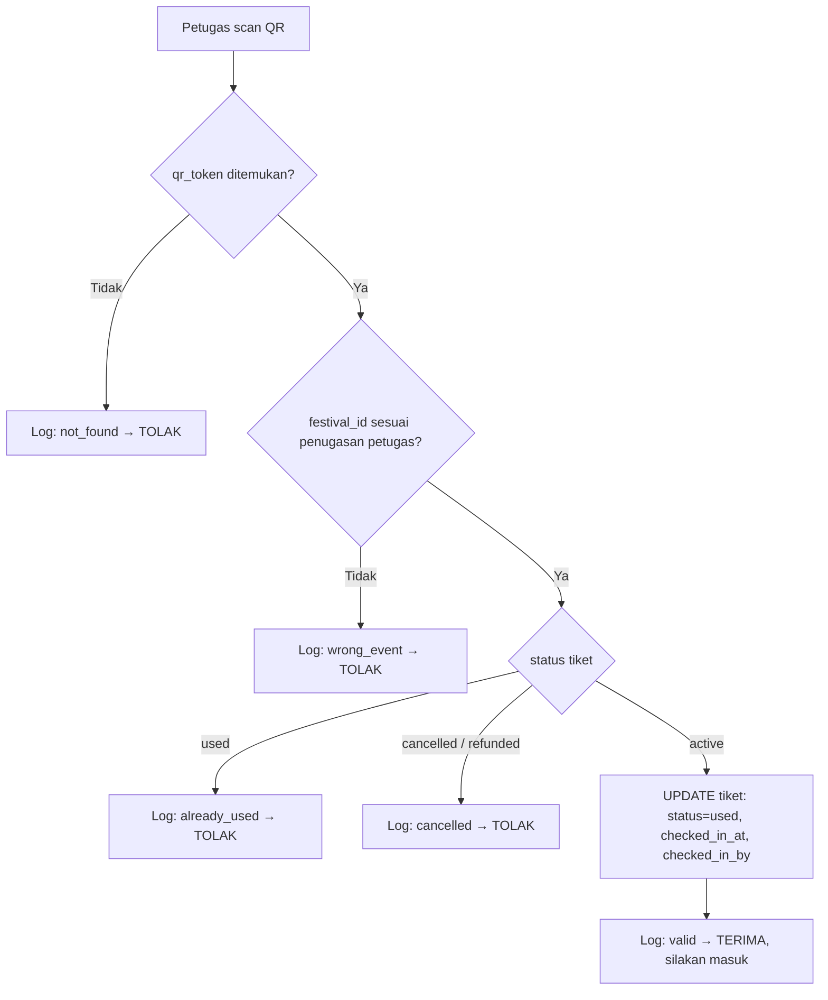

# ERD.md — Sistem Penjualan Tiket Festival

> Dirancang dari dokumen **Alur Sistem Website Penjualan Tiket Festival** (15 tahap).
> Kompatibel dengan **MySQL 8** dan **PostgreSQL 14+**.
> Diagram memakai sintaks **Mermaid** (tampil otomatis di GitHub, VS Code dengan ekstensi Mermaid, dan mermaid.live).

---

## Daftar Isi

1. [Ringkasan Aktor & Entitas](#1-ringkasan-aktor--entitas)
2. [Diagram ERD](#2-diagram-erd)
3. [Daftar Relasi](#3-daftar-relasi)
4. [Kamus Data (Data Dictionary)](#4-kamus-data-data-dictionary)
5. [Enum & Status](#5-enum--status)
6. [Diagram Status (State Machine)](#6-diagram-status-state-machine)
7. [Aturan Bisnis & Constraint](#7-aturan-bisnis--constraint)
8. [Index yang Disarankan](#8-index-yang-disarankan)
9. [Pemetaan Alur → Tabel](#9-pemetaan-alur--tabel)
10. [Contoh Query Penting](#10-contoh-query-penting)

---

## 1. Ringkasan Aktor & Entitas

### Aktor
| Aktor | Implementasi di database | Keterangan |
|---|---|---|
| **Guest** | *Tidak ada tabel* | Pengunjung tanpa login, hanya membaca data publik |
| **Customer** | `users` (role = `customer`) | Membeli tiket, melihat My Tickets |
| **Organizer** | `users` (role = `organizer`) + `organizer_profiles` | Membuat & mengelola festival |
| **Admin** | `users` (role = `admin`) | Menyetujui/menolak festival |
| **Petugas (Gate Staff)** | `users` (role = `staff`) + `festival_staff` | Scan QR saat check-in |

### Entitas (15 tabel)
| # | Tabel | Fungsi singkat |
|---|---|---|
| 1 | `users` | Akun semua aktor |
| 2 | `organizer_profiles` | Profil/informasi organizer |
| 3 | `festival_categories` | Kategori festival (musik, kuliner, seni, dll.) untuk filter |
| 4 | `festivals` | Data festival/event |
| 5 | `festival_schedules` | Jadwal/rundown acara |
| 6 | `festival_faqs` | FAQ per festival |
| 7 | `festival_approvals` | Riwayat review Admin (setuju/tolak) |
| 8 | `ticket_types` | Jenis tiket, harga, kuota, periode jual |
| 9 | `vouchers` | Kode diskon/voucher |
| 10 | `orders` | Header pesanan |
| 11 | `order_items` | Rincian tiket per pesanan |
| 12 | `payments` | Transaksi payment gateway |
| 13 | `tickets` | E-Ticket individual + QR |
| 14 | `checkin_logs` | Log setiap percobaan scan (valid/invalid) |
| 15 | `festival_staff` | Penugasan petugas ke festival |

---

## 2. Diagram ERD



> **Catatan membaca notasi:** `||` = tepat satu · `|o` = nol atau satu · `o{` = nol atau banyak · `|{` = satu atau banyak.

---

## 3. Daftar Relasi

| # | Tabel induk (1) | Tabel anak (N) | Kardinalitas | FK | On Delete | Alasan |
|---|---|---|---|---|---|---|
| 1 | `users` | `organizer_profiles` | 1 : 0..1 | `user_id` | CASCADE | Hanya user ber-role organizer punya profil |
| 2 | `organizer_profiles` | `festivals` | 1 : N | `organizer_id` | RESTRICT | Festival tidak boleh yatim |
| 3 | `festival_categories` | `festivals` | 1 : N | `category_id` | RESTRICT | Kategori terpakai tidak boleh dihapus |
| 4 | `festivals` | `festival_schedules` | 1 : N | `festival_id` | CASCADE | Jadwal ikut festival |
| 5 | `festivals` | `festival_faqs` | 1 : N | `festival_id` | CASCADE | FAQ ikut festival |
| 6 | `festivals` | `festival_approvals` | 1 : N | `festival_id` | CASCADE | Riwayat review bisa berkali-kali (ditolak → revisi → review ulang) |
| 7 | `users` (admin) | `festival_approvals` | 1 : N | `admin_id` | RESTRICT | Jejak audit siapa yang menyetujui |
| 8 | `festivals` | `ticket_types` | 1 : N | `festival_id` | RESTRICT | Tidak boleh hapus bila ada tiket terjual |
| 9 | `festivals` | `vouchers` | 1 : N (opsional) | `festival_id` | SET NULL | Voucher global bila NULL |
| 10 | `users` (customer) | `orders` | 1 : N | `user_id` | RESTRICT | Riwayat transaksi harus tetap ada |
| 11 | `festivals` | `orders` | 1 : N | `festival_id` | RESTRICT | Order milik satu festival |
| 12 | `vouchers` | `orders` | 1 : N (opsional) | `voucher_id` | SET NULL | Order boleh tanpa voucher |
| 13 | `orders` | `order_items` | 1 : 1..N | `order_id` | CASCADE | Order minimal punya 1 item |
| 14 | `ticket_types` | `order_items` | 1 : N | `ticket_type_id` | RESTRICT | Menjaga integritas histori |
| 15 | `orders` | `payments` | 1 : N | `order_id` | RESTRICT | Satu order bisa punya beberapa percobaan bayar |
| 16 | `orders` | `tickets` | 1 : N | `order_id` | RESTRICT | Tiket lahir dari order paid |
| 17 | `order_items` | `tickets` | 1 : N | `order_item_id` | RESTRICT | Qty 3 → 3 baris tiket |
| 18 | `ticket_types` | `tickets` | 1 : N | `ticket_type_id` | RESTRICT | Jenis tiket (VIP, Reguler) |
| 19 | `festivals` | `tickets` | 1 : N | `festival_id` | RESTRICT | Denormalisasi untuk validasi cepat saat scan |
| 20 | `tickets` | `checkin_logs` | 1 : N | `ticket_id` | SET NULL | Banyak percobaan scan per tiket |
| 21 | `users` (staff) | `checkin_logs` | 1 : N | `staff_id` | RESTRICT | Jejak audit petugas |
| 22 | `festivals` ↔ `users` (staff) | `festival_staff` | M : N | `festival_id`, `user_id` | CASCADE | Tabel penghubung penugasan petugas |

### Relasi Many-to-Many
- **Festival ↔ Petugas** → `festival_staff` (UK gabungan `festival_id + user_id`).
- **Order ↔ Ticket Type** → `order_items` (menyimpan `quantity` & harga saat itu).

---

## 4. Kamus Data (Data Dictionary)

### 4.1 `users`
| Kolom | Tipe | Null | Keterangan |
|---|---|---|---|
| id | BIGINT UNSIGNED PK AI | N | |
| name | VARCHAR(100) | N | Nama lengkap |
| email | VARCHAR(150) UNIQUE | N | Dipakai untuk login |
| phone | VARCHAR(20) | Y | Format 08xx / 628xx |
| password_hash | VARCHAR(255) | N | **bcrypt/argon2**, jangan simpan plaintext |
| role | ENUM | N | `admin`, `organizer`, `staff`, `customer` (default `customer`) |
| is_active | BOOLEAN | N | Default `true`; `false` = diblokir |
| email_verified_at | TIMESTAMP | Y | |
| created_at / updated_at | TIMESTAMP | N | |

### 4.2 `organizer_profiles`
| Kolom | Tipe | Null | Keterangan |
|---|---|---|---|
| id | BIGINT PK | N | |
| user_id | BIGINT FK UNIQUE | N | → `users.id` |
| organization_name | VARCHAR(150) | N | Ditampilkan di detail festival (alur no. 2) |
| description | TEXT | Y | |
| logo_url | VARCHAR(255) | Y | |
| contact_email / contact_phone | VARCHAR | Y | |
| website / instagram | VARCHAR(150) | Y | |

### 4.3 `festival_categories`
| Kolom | Tipe | Null | Keterangan |
|---|---|---|---|
| id | BIGINT PK | N | |
| name | VARCHAR(80) UNIQUE | N | Musik, Kuliner, Seni, Budaya, Teknologi |
| slug | VARCHAR(100) UNIQUE | N | Untuk URL & filter |

### 4.4 `festivals`
| Kolom | Tipe | Null | Keterangan |
|---|---|---|---|
| id | BIGINT PK | N | |
| organizer_id | BIGINT FK | N | → `organizer_profiles.id` |
| category_id | BIGINT FK | N | → `festival_categories.id` |
| title | VARCHAR(150) | N | |
| slug | VARCHAR(180) UNIQUE | N | URL ramah SEO |
| description | TEXT | N | |
| poster_url / banner_url | VARCHAR(255) | Y | |
| venue_name | VARCHAR(150) | N | |
| address | VARCHAR(255) | N | |
| city | VARCHAR(80) | N | Untuk filter |
| latitude / longitude | DECIMAL(10,7) | Y | Untuk peta |
| start_at / end_at | DATETIME | N | `end_at > start_at` |
| terms_conditions | TEXT | Y | Ketentuan festival |
| max_tickets_per_order | INT | N | Default 5 |
| status | ENUM | N | Lihat [§5](#5-enum--status), default `draft` |
| published_at | TIMESTAMP | Y | Diisi saat tampil ke publik |
| deleted_at | TIMESTAMP | Y | *Soft delete* |

### 4.5 `festival_schedules`
| Kolom | Tipe | Null | Keterangan |
|---|---|---|---|
| id | BIGINT PK | N | |
| festival_id | BIGINT FK | N | |
| title | VARCHAR(150) | N | Nama sesi/penampil |
| description | TEXT | Y | |
| performer | VARCHAR(150) | Y | |
| start_at / end_at | DATETIME | N | Harus berada dalam rentang festival |
| stage | VARCHAR(80) | Y | Nama panggung/area |
| sort_order | INT | N | Urutan tampil |

### 4.6 `festival_faqs`
| Kolom | Tipe | Null | Keterangan |
|---|---|---|---|
| id | BIGINT PK | N | |
| festival_id | BIGINT FK | N | |
| question | VARCHAR(255) | N | |
| answer | TEXT | N | |
| sort_order | INT | N | |

### 4.7 `festival_approvals`
| Kolom | Tipe | Null | Keterangan |
|---|---|---|---|
| id | BIGINT PK | N | |
| festival_id | BIGINT FK | N | |
| admin_id | BIGINT FK | N | → `users.id` (role admin) |
| decision | ENUM | N | `approved` / `rejected` |
| notes | TEXT | Y | **Wajib** bila `rejected` (alasan untuk organizer) |
| reviewed_at | TIMESTAMP | N | |

### 4.8 `ticket_types`
| Kolom | Tipe | Null | Keterangan |
|---|---|---|---|
| id | BIGINT PK | N | |
| festival_id | BIGINT FK | N | |
| name | VARCHAR(80) | N | Early Bird, Regular, VIP |
| description | TEXT | Y | Benefit tiket |
| price | DECIMAL(12,2) | N | ≥ 0 |
| quota | INT | N | ≥ 1 |
| sold_count | INT | N | Default 0; **sisa kuota = quota − sold_count** |
| max_per_order | INT | N | Batas pembelian per order |
| sale_start_at / sale_end_at | DATETIME | N | Periode penjualan |
| is_active | BOOLEAN | N | `false` = penjualan ditutup manual |

### 4.9 `vouchers`
| Kolom | Tipe | Null | Keterangan |
|---|---|---|---|
| id | BIGINT PK | N | |
| festival_id | BIGINT FK | Y | `NULL` = voucher global |
| code | VARCHAR(30) UNIQUE | N | Disimpan UPPERCASE |
| discount_type | ENUM | N | `percentage` / `fixed` |
| discount_value | DECIMAL(12,2) | N | Persen (0–100) atau nominal |
| max_discount | DECIMAL(12,2) | Y | Batas atas untuk tipe persen |
| min_purchase | DECIMAL(12,2) | N | Minimal subtotal, default 0 |
| usage_limit | INT | Y | `NULL` = tanpa batas |
| used_count | INT | N | Default 0 |
| valid_from / valid_until | DATETIME | N | |
| is_active | BOOLEAN | N | |

### 4.10 `orders`
| Kolom | Tipe | Null | Keterangan |
|---|---|---|---|
| id | BIGINT PK | N | |
| order_number | VARCHAR(30) UNIQUE | N | Contoh: `ORD-20261011-000123` |
| user_id | BIGINT FK | N | Pembeli |
| festival_id | BIGINT FK | N | |
| voucher_id | BIGINT FK | Y | |
| subtotal | DECIMAL(12,2) | N | Σ order_items.subtotal |
| discount_amount | DECIMAL(12,2) | N | Default 0 |
| service_fee | DECIMAL(12,2) | N | Default 0 |
| tax_amount | DECIMAL(12,2) | N | Default 0 (opsional) |
| total_amount | DECIMAL(12,2) | N | `subtotal − discount + service_fee + tax` |
| status | ENUM | N | Default `pending` |
| expires_at | DATETIME | N | Batas bayar (mis. created_at + 30 menit) |
| paid_at | TIMESTAMP | Y | |

### 4.11 `order_items`
| Kolom | Tipe | Null | Keterangan |
|---|---|---|---|
| id | BIGINT PK | N | |
| order_id | BIGINT FK | N | |
| ticket_type_id | BIGINT FK | N | |
| ticket_name_snapshot | VARCHAR(80) | N | Nama jenis tiket **saat dibeli** |
| quantity | INT | N | ≥ 1 |
| unit_price | DECIMAL(12,2) | N | Harga **saat dibeli** (snapshot) |
| subtotal | DECIMAL(12,2) | N | `quantity × unit_price` |

> **Mengapa snapshot?** Bila organizer mengubah harga/nama tiket setelah order dibuat, histori order tetap akurat.

### 4.12 `payments`
| Kolom | Tipe | Null | Keterangan |
|---|---|---|---|
| id | BIGINT PK | N | |
| order_id | BIGINT FK | N | |
| provider | VARCHAR(30) | N | Nama payment gateway |
| external_id | VARCHAR(100) UNIQUE | N | ID transaksi dari gateway (kunci **idempotensi** webhook) |
| payment_method | VARCHAR(40) | Y | VA BCA, QRIS, e-wallet, dll. |
| amount | DECIMAL(12,2) | N | Harus sama dengan `orders.total_amount` |
| status | ENUM | N | Default `pending` |
| payment_url | VARCHAR(500) | Y | Link/redirect pembayaran |
| gateway_payload | JSON | Y | Respons mentah webhook untuk audit |
| paid_at | TIMESTAMP | Y | |

### 4.13 `tickets`
| Kolom | Tipe | Null | Keterangan |
|---|---|---|---|
| id | BIGINT PK | N | |
| order_id | BIGINT FK | N | |
| order_item_id | BIGINT FK | N | |
| ticket_type_id | BIGINT FK | N | |
| festival_id | BIGINT FK | N | Denormalisasi → cek "sesuai event" cepat |
| ticket_code | VARCHAR(30) UNIQUE | N | Kode tercetak/terbaca manusia, mis. `TKT-7H2K9QXM` |
| qr_token | VARCHAR(100) UNIQUE | N | Nilai di dalam QR (acak/ditandatangani, **bukan** ID berurutan) |
| holder_name | VARCHAR(100) | Y | Nama pemegang tiket |
| status | ENUM | N | `active` default |
| checked_in_at | TIMESTAMP | Y | Waktu check-in (alur no. 11) |
| checked_in_by | BIGINT FK | Y | Petugas yang memindai |

### 4.14 `checkin_logs`
| Kolom | Tipe | Null | Keterangan |
|---|---|---|---|
| id | BIGINT PK | N | |
| ticket_id | BIGINT FK | Y | `NULL` bila QR tidak ditemukan |
| festival_id | BIGINT FK | N | Festival tempat petugas bertugas |
| staff_id | BIGINT FK | N | |
| scanned_value | VARCHAR(100) | N | Isi QR yang dipindai |
| result | ENUM | N | Hasil validasi (lihat §5) |
| message | VARCHAR(150) | Y | Pesan untuk ditampilkan ke petugas |
| scanned_at | TIMESTAMP | N | |

### 4.15 `festival_staff`
| Kolom | Tipe | Null | Keterangan |
|---|---|---|---|
| id | BIGINT PK | N | |
| festival_id | BIGINT FK | N | |
| user_id | BIGINT FK | N | Role harus `staff` |
| assigned_at | TIMESTAMP | N | |
| — | UNIQUE | — | (`festival_id`, `user_id`) |

---

## 5. Enum & Status

| Tabel.kolom | Nilai | Arti |
|---|---|---|
| `users.role` | `admin` · `organizer` · `staff` · `customer` | Peran akun |
| `festivals.status` | `draft` | Organizer masih menyusun |
| | `pending_review` | Diajukan, menunggu Admin |
| | `approved` | Disetujui Admin, belum tampil |
| | `rejected` | Ditolak, organizer perlu revisi |
| | `published` | **Tampil ke Guest & Customer**, tiket bisa dibeli |
| | `ongoing` | Festival sedang berlangsung |
| | `finished` | Selesai |
| | `cancelled` | Dibatalkan |
| `festival_approvals.decision` | `approved` · `rejected` | Keputusan Admin |
| `vouchers.discount_type` | `percentage` · `fixed` | Jenis potongan |
| `orders.status` | `pending` | Menunggu pembayaran |
| | `paid` | Pembayaran berhasil |
| | `expired` | Lewat `expires_at` |
| | `cancelled` | Dibatalkan user/sistem |
| | `refunded` | Dana dikembalikan |
| `payments.status` | `pending` · `success` · `failed` · `expired` · `refunded` | Status dari gateway |
| `tickets.status` | `active` | Siap dipakai |
| | `used` | Sudah check-in |
| | `cancelled` | Dibatalkan |
| | `refunded` | Direfund |
| `checkin_logs.result` | `valid` | Tiket sah, check-in diterima |
| | `not_found` | QR tidak ditemukan |
| | `already_used` | Tiket sudah dipakai |
| | `cancelled` | Tiket dibatalkan |
| | `wrong_event` | Tiket milik festival lain |
| | `invalid_status` | Status lain yang tidak memenuhi syarat |

---

## 6. Diagram Status (State Machine)

### 6.1 Festival


### 6.2 Order & Payment


### 6.3 Ticket


### 6.4 Alur Validasi Check-in


---

## 7. Aturan Bisnis & Constraint

### 7.1 Integritas Data (CHECK / UNIQUE)
| Tabel | Aturan |
|---|---|
| `users` | `email` unik; `role` hanya 4 nilai |
| `festivals` | `end_at > start_at`; `slug` unik |
| `ticket_types` | `price >= 0`; `quota >= 1`; `0 <= sold_count <= quota`; `sale_end_at > sale_start_at` |
| `order_items` | `quantity >= 1`; `subtotal = quantity * unit_price` |
| `orders` | `total_amount = subtotal - discount_amount + service_fee + tax_amount` dan `>= 0` |
| `vouchers` | `code` unik; `used_count <= usage_limit` (bila ada); persen 0–100 |
| `payments` | `external_id` unik (cegah webhook ganda) |
| `tickets` | `ticket_code` & `qr_token` unik |
| `festival_staff` | UNIQUE (`festival_id`, `user_id`) |

### 7.2 Aturan Per Tahap Alur
| Tahap alur | Aturan di backend |
|---|---|
| **1–2 Guest** | Hanya festival `status = published` dan `deleted_at IS NULL` yang ditampilkan |
| **3–4 Beli Tiket** | Endpoint order wajib token login; tanpa token → 401 → frontend arahkan ke Login/Daftar lalu **kembali ke festival yang sama** |
| **5 Checkout** | Validasi: tiket `is_active`, dalam periode jual, `quantity ≤ max_per_order`, `quantity ≤ quota − sold_count`; hitung subtotal, voucher, biaya layanan |
| **6 Order** | Dalam **satu transaksi DB**: buat `orders` + `order_items`, naikkan `ticket_types.sold_count` (kuota ditahan), set `expires_at`, naikkan `vouchers.used_count` |
| **7 Pembayaran** | Buat `payments` status `pending` dengan `external_id` dari gateway |
| **8 Berhasil** | Webhook gateway → verifikasi **signature** → cek `amount` = `total_amount` → update `payments.status = success`, `orders.status = paid`, `paid_at` |
| **9 E-Ticket** | Untuk setiap `order_items.quantity` buat 1 baris `tickets` dengan `ticket_code` & `qr_token` unik. Operasi **idempotent** (jangan terbit dua kali bila webhook dikirim ulang) |
| **10–12 Check-in** | Validasi sesuai diagram §6.4; **setiap scan dicatat** di `checkin_logs` baik valid maupun tidak |
| **13 Organizer** | Organizer hanya boleh CRUD festival milik `organizer_id`-nya; data penjualan/peserta difilter pada festival miliknya |
| **14 Admin** | Perubahan `pending_review → approved/rejected` wajib menulis `festival_approvals`; penolakan wajib `notes` |

### 7.3 Pencegahan Masalah Konkurensi (Overselling)
Kuota adalah sumber bug paling umum. Gunakan salah satu cara:

```sql
-- Cara atomik (disarankan): gagal bila kuota tidak cukup
UPDATE ticket_types
SET    sold_count = sold_count + :qty
WHERE  id = :ticket_type_id
  AND  is_active = 1
  AND  sold_count + :qty <= quota;
-- Jika affected_rows = 0  →  kuota tidak cukup → batalkan transaksi (HTTP 409)
```
atau `SELECT ... FOR UPDATE` pada baris `ticket_types` di dalam transaksi.

### 7.4 Pengembalian Kuota (Order Kedaluwarsa)
Job terjadwal (cron tiap 1–5 menit):
```sql
-- 1) cari order pending yang lewat batas
-- 2) ubah ke expired, payments pending -> expired
-- 3) kembalikan kuota:
UPDATE ticket_types tt
JOIN   order_items oi ON oi.ticket_type_id = tt.id
SET    tt.sold_count = tt.sold_count - oi.quantity
WHERE  oi.order_id = :order_id;
-- 4) kurangi vouchers.used_count bila voucher dipakai
```

### 7.5 Keamanan Data
- `password_hash` memakai **bcrypt/argon2**.
- `qr_token` acak (≥ 32 karakter, mis. UUID v4 / HMAC) → tidak bisa ditebak atau dipalsukan dengan menaikkan ID.
- Respons webhook gateway **wajib diverifikasi signature**; jangan percaya status dari frontend.
- Data kartu **tidak disimpan** — hanya referensi transaksi gateway.
- Gunakan *prepared statement* / ORM untuk mencegah SQL Injection.

---

## 8. Index yang Disarankan

| Tabel | Index | Tujuan |
|---|---|---|
| `festivals` | (`status`, `published_at`) | Homepage: daftar festival terbit |
| `festivals` | (`category_id`, `city`, `start_at`) | Filter & pencarian |
| `festivals` | FULLTEXT / GIN (`title`, `description`) | Pencarian teks |
| `festivals` | (`organizer_id`) | Dashboard organizer |
| `ticket_types` | (`festival_id`, `is_active`) | Daftar tiket di detail festival |
| `orders` | (`user_id`, `created_at`) | Riwayat pesanan user |
| `orders` | (`festival_id`, `status`) | Laporan penjualan organizer |
| `orders` | (`status`, `expires_at`) | Job pembersihan order kedaluwarsa |
| `payments` | UNIQUE (`external_id`) | Pencocokan webhook |
| `payments` | (`order_id`, `status`) | |
| `tickets` | UNIQUE (`qr_token`) | **Scan QR cepat** |
| `tickets` | (`order_id`) | My Tickets |
| `tickets` | (`festival_id`, `status`) | Statistik peserta/check-in |
| `checkin_logs` | (`festival_id`, `scanned_at`) | Laporan check-in |
| `festival_approvals` | (`festival_id`, `reviewed_at`) | Riwayat review |

---

## 9. Pemetaan Alur → Tabel

| No. | Tahap alur | Tabel yang dibaca/ditulis |
|---|---|---|
| 1 | Akses Homepage (Guest) | R: `festivals`, `festival_categories`, `ticket_types` (harga mulai) |
| 2 | Detail Festival | R: `festivals`, `ticket_types`, `festival_schedules`, `festival_faqs`, `organizer_profiles` |
| 3 | Tekan Beli Tiket | — (cek token di aplikasi) |
| 4 | Login / Daftar | R/W: `users` |
| 5 | Pilih Tiket & Checkout | R: `ticket_types`, `vouchers` |
| 6 | Pembuatan Order | W: `orders`, `order_items`; U: `ticket_types.sold_count`, `vouchers.used_count` |
| 7 | Pembayaran | W: `payments` |
| 8 | Pembayaran Berhasil | U: `payments`, `orders` |
| 9 | Pembuatan E-Ticket | W: `tickets`; R (My Tickets): `tickets`, `festivals` |
| 10 | Check-in: scan | R: `tickets`, `festival_staff`; W: `checkin_logs` |
| 11 | Tiket Valid | U: `tickets` (status, checked_in_at/by); W: `checkin_logs` |
| 12 | Tiket Tidak Valid | W: `checkin_logs` (result ≠ valid) |
| 13 | Pengelolaan Organizer | CRUD: `festivals`, `ticket_types`, `festival_schedules`, `festival_faqs`; R: `orders`, `tickets` |
| 14 | Persetujuan Admin | W: `festival_approvals`; U: `festivals.status` |
| 15 | Ringkasan alur | Gabungan seluruh tabel di atas |

---

## 10. Contoh Query Penting

**Homepage — festival terbit + harga mulai dari**
```sql
SELECT f.id, f.title, f.slug, f.poster_url, f.city, f.start_at,
       MIN(tt.price) AS starting_price
FROM   festivals f
JOIN   ticket_types tt ON tt.festival_id = f.id AND tt.is_active = 1
WHERE  f.status = 'published' AND f.deleted_at IS NULL
GROUP  BY f.id
ORDER  BY f.start_at ASC
LIMIT  12;
```

**Sisa kuota per jenis tiket (detail festival)**
```sql
SELECT id, name, price, (quota - sold_count) AS remaining,
       (NOW() BETWEEN sale_start_at AND sale_end_at AND is_active = 1) AS on_sale
FROM   ticket_types
WHERE  festival_id = :festival_id;
```

**My Tickets — e-ticket milik user**
```sql
SELECT t.ticket_code, t.qr_token, t.status, tt.name AS ticket_type,
       f.title, f.start_at, f.venue_name
FROM   tickets t
JOIN   orders o         ON o.id  = t.order_id
JOIN   ticket_types tt  ON tt.id = t.ticket_type_id
JOIN   festivals f      ON f.id  = t.festival_id
WHERE  o.user_id = :user_id AND o.status = 'paid'
ORDER  BY f.start_at DESC;
```

**Check-in (atomik, hindari dua petugas memindai bersamaan)**
```sql
UPDATE tickets
SET    status = 'used', checked_in_at = NOW(), checked_in_by = :staff_id
WHERE  qr_token = :token AND festival_id = :festival_id AND status = 'active';
-- affected_rows = 1 → valid.  = 0 → cek penyebab (not_found / already_used / cancelled), lalu catat di checkin_logs
```

**Dashboard organizer — penjualan per jenis tiket**
```sql
SELECT tt.name,
       tt.quota,
       tt.sold_count,
       SUM(CASE WHEN o.status = 'paid' THEN oi.subtotal ELSE 0 END) AS revenue
FROM   ticket_types tt
LEFT   JOIN order_items oi ON oi.ticket_type_id = tt.id
LEFT   JOIN orders o       ON o.id = oi.order_id
WHERE  tt.festival_id = :festival_id
GROUP  BY tt.id;
```

**Statistik check-in festival**
```sql
SELECT COUNT(*)                                   AS total_tickets,
       SUM(status = 'used')                       AS checked_in,
       ROUND(SUM(status = 'used') / COUNT(*) * 100, 1) AS pct
FROM   tickets
WHERE  festival_id = :festival_id AND status IN ('active','used');
```

---

### Catatan Desain

1. **`tickets.festival_id` sengaja didenormalisasi** agar validasi "sesuai event" saat scan tidak butuh join berlapis.
2. **Snapshot harga/nama** di `order_items` menjaga histori transaksi meski data master berubah.
3. **`checkin_logs` terpisah dari `tickets`** supaya percobaan scan yang gagal (QR palsu, tiket ganda) tetap terekam untuk audit.
4. **`festival_approvals` berupa riwayat**, bukan kolom tunggal di `festivals`, karena festival bisa ditolak lalu direvisi dan diajukan lagi.
5. Bila perlu disederhanakan untuk waktu terbatas, tabel yang boleh ditunda: `festival_faqs`, `festival_categories`, `vouchers`, `festival_staff`, dan `checkin_logs`. Inti minimal: `users`, `organizer_profiles`, `festivals`, `ticket_types`, `orders`, `order_items`, `payments`, `tickets`.
