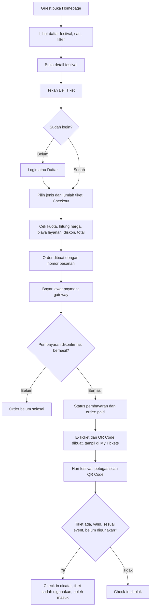
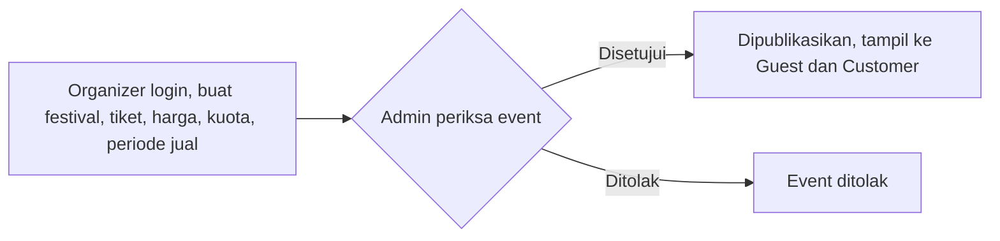
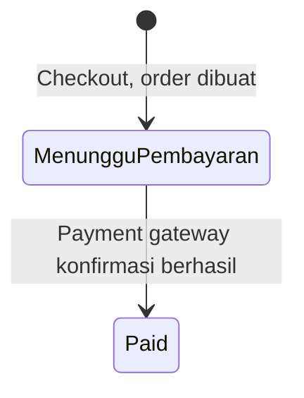
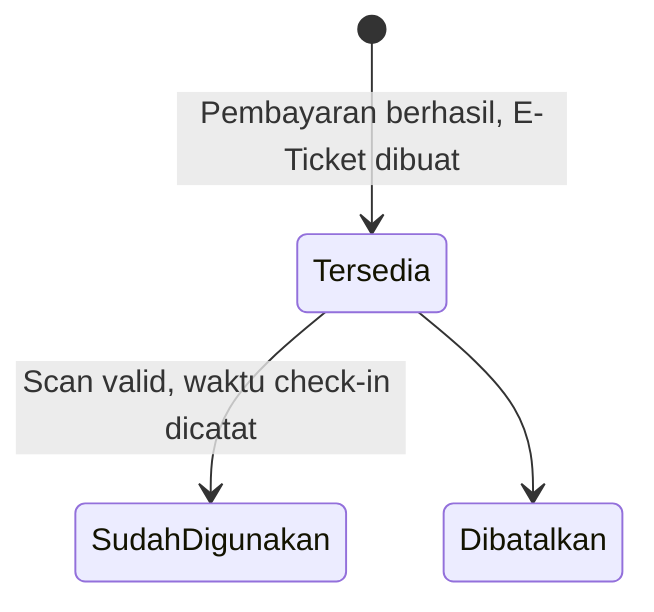
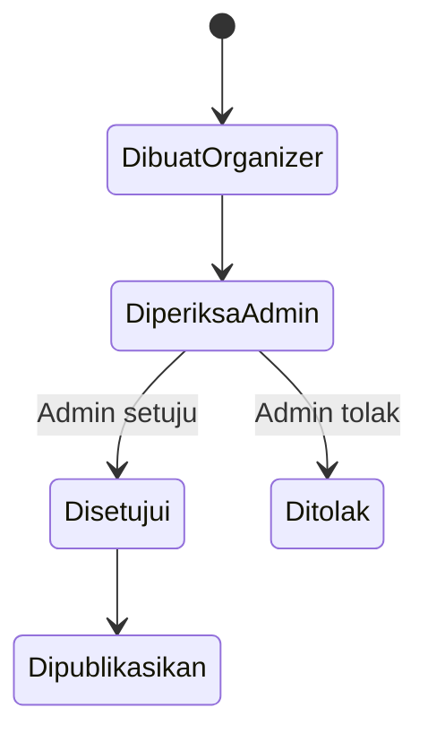

# PRD - ConserId Frontend

**Produk:** Website penjualan tiket festival
**Repo:** Alv-Putra/Frontend_tiketkonser (`frontend_konser` v0.1.0)
**Backend:** Express + Prisma (`Konser-Be/Backend_UKK`)
**Versi:** 1.1
**Sumber:** `package.json`, README, dokumen alur sistem (`alur_tiket_konser.docx`)

## 1. Ringkasan

ConserId adalah website penjualan tiket festival. Guest dapat melihat festival tanpa akun. Pembelian tiket mewajibkan login. Setelah payment gateway mengonfirmasi pembayaran, sistem membuat E-Ticket ber-QR Code yang di-scan petugas saat check-in. Organizer membuat dan mengelola festival; Admin menyetujui atau menolak event sebelum tampil ke publik.

## 2. Peran

| Peran | Akses |
|---|---|
| Guest | Homepage, daftar festival, pencarian, filter, detail festival. Tanpa login. |
| Customer | Akses Guest + checkout, pembayaran, My Tickets. Role backend `buyer` dipetakan menjadi `customer` di FE. |
| Organizer | Login; buat dan kelola festival, jenis tiket, harga, kuota, periode penjualan; lihat data penjualan dan peserta festival miliknya. |
| Admin | Periksa, setujui, atau tolak event. |
| Petugas | Scan QR Code tiket saat check-in. |

## 3. Alur Utama

### 3.1 Pembelian tiket sampai check-in

### 3.2 Pengelolaan event

## 4. Status

### 4.1 Order

Order belum dianggap selesai sebelum pembayaran dikonfirmasi berhasil.

### 4.2 Tiket

Check-in ditolak jika QR Code tidak ditemukan, tiket sudah digunakan, tiket dibatalkan, atau status tiket tidak memenuhi syarat.

### 4.3 Event

## 5. Kebutuhan Fungsional

Nomor mengikuti langkah pada dokumen alur.

| ID | Langkah alur | Kebutuhan |
|---|---|---|
| FR-1 | 1 Akses Homepage | Homepage, daftar festival, pencarian, dan filter dapat diakses tanpa login. |
| FR-2 | 2 Detail Festival | Detail menampilkan poster, deskripsi, tanggal, lokasi, jadwal, jenis tiket, harga, kuota, informasi organizer, FAQ, ketentuan. |
| FR-3 | 3 Beli Tiket | Tombol Beli Tiket memeriksa status login; pembelian membutuhkan autentikasi. |
| FR-4 | 4 Login/Daftar | Login dan registrasi. Register mengirim `fullName`, `email`, `password`. Setelah register, user wajib verifikasi email sebelum login (tidak auto-login). Setelah login atau registrasi, user melanjutkan pembelian. |
| FR-5 | 4 Login/Daftar | Halaman `/verify-email?token=...` dan `/reset-password?token=...` untuk tautan dari email backend. |
| FR-6 | 5 Checkout | Pilih jenis dan jumlah tiket; sistem cek kuota, hitung harga, biaya layanan, diskon atau voucher jika tersedia, tampilkan total. |
| FR-7 | 6 Order | Order dibuat dengan nomor pesanan; menyimpan user, tiket, jumlah, harga, diskon, biaya layanan, pajak jika digunakan, total. |
| FR-8 | 7 Pembayaran | Pembayaran lewat payment gateway; sistem menunggu konfirmasi. |
| FR-9 | 8 Pembayaran Berhasil | Backend memperbarui status pembayaran dan order menjadi paid setelah konfirmasi. |
| FR-10 | 9 E-Ticket | My Tickets menampilkan tiket dengan kode tiket dan QR Code (`qrcode.react`). |
| FR-11 | 10-12 Check-in | Petugas scan QR Code; sistem memeriksa tiket ada, valid, sesuai event, belum digunakan. Valid: catat waktu check-in, status menjadi sudah digunakan. Tidak valid: tolak. |
| FR-12 | 13 Organizer | Organizer membuat dan mengelola festival, jenis tiket, harga, kuota, periode penjualan, informasi event; melihat data penjualan dan peserta festival miliknya. |
| FR-13 | 14 Admin | Admin menyetujui atau menolak event; event disetujui dan dipublikasikan tampil ke Guest dan Customer. |

## 6. Aturan Bisnis

- Browsing tidak butuh login; pembelian wajib login.
- Order selesai hanya setelah payment gateway mengonfirmasi pembayaran.
- Setiap tiket yang berhasil dibeli memiliki kode tiket dan QR Code.
- Satu tiket hanya dapat digunakan untuk check-in satu kali.
- Hanya event yang disetujui dan dipublikasikan yang tampil ke publik.
- Organizer hanya melihat data festival yang dikelolanya.

## 7. Teknis

### 7.1 Stack

| Area | Teknologi |
|---|---|
| Framework | Next.js 16 + React 19 + react-dom |
| Bahasa | TypeScript (`.ts`/`.tsx`) |
| Styling | Tailwind CSS 4 |
| State | Zustand 5 |
| Animasi | Framer Motion |
| Ikon | Lucide React |
| QR Code | qrcode.react |
| Tanggal | date-fns |
| ID unik | uuid |
| Lint | ESLint 9 + eslint-config-next |
| Testing | Tanpa Jest; framework pengujian belum ditentukan |

### 7.2 Integrasi backend

- FE berjalan di port 3001, backend di port 3000.
- Request `/api/*` di-proxy oleh `next.config.mjs` ke `BACKEND_API_URL` (`.env.local`, mis. `http://localhost:3000`).
- Backend mengirim email verifikasi/reset dengan tautan berbasis `CLIENT_URL` (mis. `http://localhost:3001`).
- Role backend `buyer` dipetakan menjadi `customer`.
- Saat respons 401, sesi dibersihkan.
- Refresh token ada di httpOnly cookie backend, tetapi endpoint refresh meminta `refreshToken` di body sehingga tidak bisa dipakai dari browser. Perlu perbaikan di backend.

### 7.3 Migrasi

- **TypeScript:** file masih `.js` (mis. `app/page.js`); ubah menjadi `.tsx` (halaman/komponen) atau `.ts` (logika, store, util). Tambahkan `typescript`, `@types/react`, `@types/react-dom`, `@types/node`, `tsconfig.json`; `next.config.mjs` boleh menjadi `next.config.ts`.
- **Jest:** hapus `jest`, `@swc/jest`, `@swc/core`, `jest-environment-jsdom`, `identity-obj-proxy`, script `test` dan `test:watch`.
- **Versi:** `eslint-config-next` (^15) tertinggal dari `next` 16; selaraskan.

## 8. Di Luar Lingkup

- Logika bisnis, penyimpanan data, dan integrasi payment gateway sisi server (backend).

## 9. Pertanyaan Terbuka

1. Payment gateway apa yang dipakai?
2. Apakah petugas memakai role tersendiri atau akun Organizer?
3. Apa kebijakan order yang tidak dibayar dan refund?